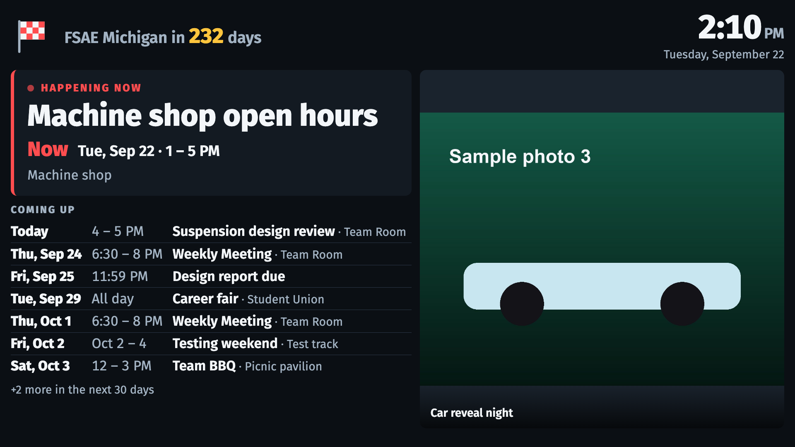

# Team room display

A Raspberry Pi in the team room boots straight into a full-screen page showing what's
coming up (meetings, deadlines, competitions), a competition countdown, and rotating team
photos. The events come from the team's **Google Calendar** and the photos from a
**Google Drive folder**; the Pi reads both every 30 seconds. The banner, countdown and
text size are set on a phone-friendly admin page on the Pi, reached over Tailscale.



## Try it on your laptop

```sh
python3 -m venv .venv && . .venv/bin/activate      # Windows: .venv\Scripts\activate
pip install -r requirements.txt
python scripts/set_password.py --write .env         # choose an admin password
python scripts/seed_demo.py                         # a demo calendar and sample photos
flask run --port 8000                               # display: http://127.0.0.1:8000/  admin: /admin
```

`seed_demo.py` makes a demo calendar file, uses `fixtures/sample_photos` as the photo
folder, and prints `CALENDAR_ICS_URL=...` and `DRIVE_FOLDER_URL=...` lines; add them to
`.env` so the **Read … now** buttons keep working. To read the real calendar and Drive
folder instead, put the secret iCal link, the folder link and the API key there
(docs/SETUP.md step 5) and run `python scripts/publish.py --every 30` in a second
terminal, which is exactly what the Pi runs as a service. Without it, the screen shows its amber "may be out of date" badge
after an hour.

## Before it goes on the wall

The open decisions from [PLAN.md §2.2](docs/PLAN.md), and where each one goes:

| Still to decide | Where it goes |
|---|---|
| Team colors | `--accent` at the top of `web/style.css` |
| Team logo | Replace `web/img/logo.svg` |
| Competition name and date | Admin page → **Settings** |
| The team's Google Calendar | Its secret iCal link goes in `/etc/display/env` on the Pi (SETUP.md step 5). Not in git |
| The team's photo folder | A Drive folder shared by link, plus a Google Cloud API key, both in `/etc/display/env` (SETUP.md step 5). Not in git |
| Display: size and resolution | Tune **Settings → Text size** in the room; re-shoot `docs/mockups/` if it isn't 1920×1080 |
| Pi model and RAM | Nothing to change for a Pi 4 (2 GB+) or Pi 5; use its official power supply |
| Team-room network | SETUP.md step 1 (Wi-Fi) or step 2 (Ethernet, DHCP reservation) |
| Admins, schedule owner, Tailscale account | SETUP.md step 3; the account must be personal Gmail/GitHub, not uconn.edu |

## How it fits together

```
Google Calendar ──secret iCal link──► scripts/publish.py --every 30 (a systemd service)
Google Drive folder ──API key──────────►  │ saves the events and photos, then
phone ──Tailscale──► nginx ──/admin──► Flask (settings, status)
                        │                 │ after every change:
                        │                 ▼ publish() writes web/data/*.json
Chromium kiosk ─────────┴── /, /data/*.json, /photos/* ◄── static files in web/
```

The screen only reads static files, so it keeps working even if the admin app is down.
Design decisions and the reasons for them: [docs/PLAN.md](docs/PLAN.md) and
[docs/SPEC.md](docs/SPEC.md).

| Folder | What's in it |
|---|---|
| `app/` | Reading the calendar (`calendar_feed.py`) and the photo folder (`drive_photos.py`, `photos.py`), `publish.py`, and the admin app: Flask, SQLite (`db.py`, `schema.sql`, `models.py`), login (`auth.py`), `status.py`, pages in `admin/` |
| `web/` | The display page: plain HTML/CSS/JS, fonts, logo. `web/data` and `web/photos` are generated |
| `scripts/` | `init_db.py`, `set_password.py`, `publish.py`, `seed_demo.py`, `backup.sh`, `netcheck.sh` |
| `pi/` | Everything installed on the Pi: nginx, systemd units, kiosk, sudoers (notes on `config.txt` are in `docs/pi-config-notes.md`) |
| `fixtures/` | The events.json schema, a sample calendar feed, and test data |
| `tests/` | `pytest` tests |
| `docs/` | The docs below, mockups, and `decisions/` (design write-ups) and `plans/` (how changes were carried out) |

## Docs

- [UPDATING.md](docs/UPDATING.md): events (in Google Calendar) and photos (in Google Drive), for everyone on the team
- [SETUP.md](docs/SETUP.md): building the Pi from a blank SD card
- [TROUBLESHOOTING.md](docs/TROUBLESHOOTING.md): when something's wrong
- [TESTING.md](docs/TESTING.md): the test checklist
- [SPEC.md](docs/SPEC.md): exactly what the screen shows and why

## Tests

```sh
pytest
```

The display page's browser tests also need Playwright
(`pip install playwright && playwright install chromium`). Without it they're skipped.
