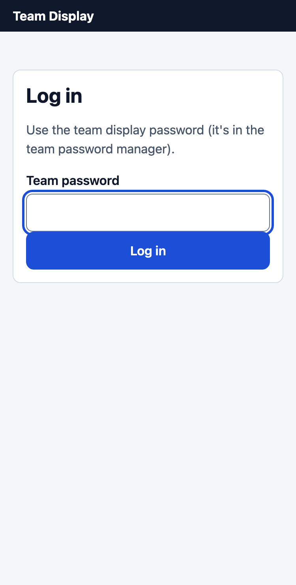
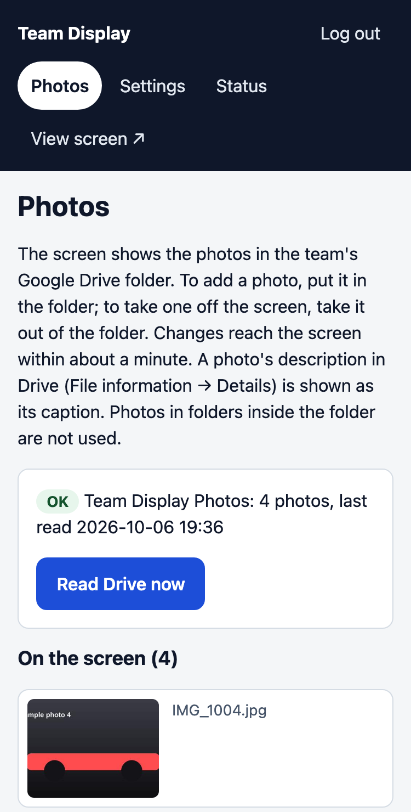
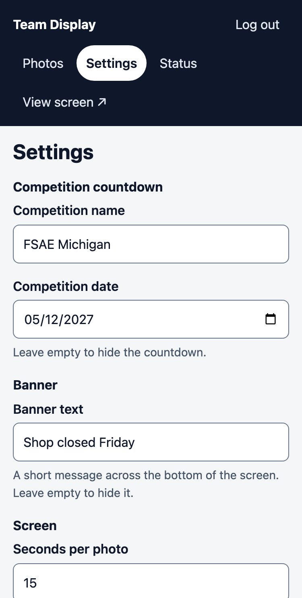
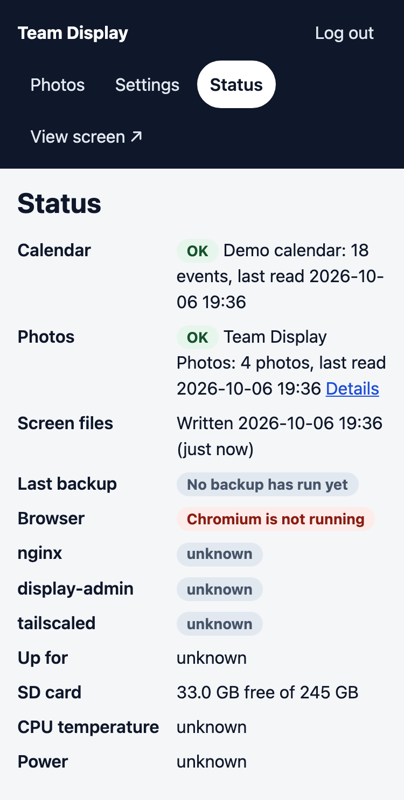

# Updating the team-room screen

The screen in the team room shows what's coming up and rotates through team photos.

- **Events** come from the team's **Google Calendar**. Add or change an event there and
  the screen follows within about a minute. There is nothing else to do.
- **Photos** come from the team's **Google Drive folder**. Put a photo in the folder and
  it's on the screen within about a minute; take it out and it leaves.
- **The banner and the countdown** are changed on the display's own admin page, from
  your phone or laptop. Those changes appear within a minute.

## Events: use Google Calendar

Ask a team lead to share the team calendar with you ("Make changes to events"). Then add
events to it like any other calendar event, from the app or the website.

| In Google Calendar | On the screen |
|---|---|
| Title | The event's name. Keep it short: "Weekly Meeting", "Design report due" |
| Date and time | When it shows, and the countdown to it ("in 2 h", "Tomorrow") |
| All day | Shown as "All day", or as a range ("Oct 2 – 4") for several days |
| Location | Shown after the title: "Team Room", "Machine shop" |
| Repeats | Works. Each week shows up as its own event |
| Description, guests, colors, reminders | Not shown. Put what people need in the title |

- **An event leaves the screen when it ends.** Until then it shows as "Happening now".
- **The screen shows the next event large, then up to 7 more** from the next 30 days.
- **To take something off the screen,** delete it in Google Calendar, or cancel it.
- **Repeating events:** to skip one week, delete just that week ("This event"). To change
  the time for the rest of the semester, change it and pick "This and following events".
- **It takes about a minute.** The Pi checks the calendar every 30 seconds and the screen
  re-reads its files every 30 seconds. Google itself sometimes takes a few minutes to pass
  a change on. Nobody needs to press anything; **Status → Read calendar now** on the admin
  page exists only for checking that the link works.

## Photos: use the Google Drive folder

Ask a team lead for the link to the team's photo folder, and to make you an **Editor** of
it. Then add photos like any other file: drag them in on a computer, or in the Google
Drive app on a phone tap **+ → Upload**. (Logged in to the admin page? **Photos → Open the
folder in Google Drive** takes you there.)

| In Google Drive | On the screen |
|---|---|
| A photo in the folder | Shown, newest first. JPEG, PNG, WebP and iPhone (HEIC) photos all work, up to 20 MB each |
| Its **description** (right-click → File information → Details) | Shown as the caption along the bottom of the photo |
| Taking it out of the folder (or deleting it) | It leaves the screen |
| Photos in a folder inside the folder | Not shown: use that for photos you want to keep but not show |
| Videos, PDFs, documents | Ignored |

- **It takes about a minute** (longer for a big batch: the Pi downloads about 20 seconds'
  worth of photos every 30 seconds). Nobody needs to press anything.
- **Photos are resized for the screen and their location data is removed** before they're
  shown. The originals in Drive are not changed.
- **The screen uses the newest 200 photos** in the folder.
- **Anyone who has the folder link can see the photos in it.** Don't post the link
  anywhere public, and only add photos the people in them are happy to have on the wall.
- **A photo isn't showing?** The admin page's **Photos** page lists files the screen can't
  use and why (too big, not a photo). Save a JPEG copy into the folder instead.

## The admin page: one-time setup (about 5 minutes)

You only need this for photos, the banner and the countdown.

1. **Ask the DAQ lead to add you** to the team's Tailscale network. You'll get an email
   invite (or a link to the shared display).
2. **Install Tailscale** on your phone or laptop (App Store, Google Play, or
   [tailscale.com/download](https://tailscale.com/download)) and sign in with the account
   the invite went to.
3. **Turn Tailscale on** (the switch in the app). It only needs to be on while you're
   making changes.
4. **Open the admin page:** `https://daq-display.<tailnet>.ts.net/admin`. The DAQ lead has
   the exact address; bookmark it. Log in with the **team display password** from the
   team password manager.

## Photos page

Shows the photos that are on the screen, the files from the folder the screen can't use
(and why), and when the folder was last read. Nothing is uploaded here any more: to
change the photos, change the folder. **Read Drive now** reads the folder straight away,
mostly useful to check that it works.

## Settings

- **Competition countdowns:** up to two, each a name and a date, e.g. "Gas car: FSAE
  Michigan" and "EV car: FSAE Michigan". The screen shows one line for each ("Gas car: FSAE
  Michigan in 231 days"), the sooner one first, and drops each once its day has passed.
  Clear a date to hide that countdown.
- **Banner:** a one-line message across the bottom of the screen ("Shop closed Friday").
  Clear it to hide it.
- **Seconds per photo:** how long each photo stays up.
- **Text size:** 1.0 is normal. If people at the back of the room can't read the screen,
  try 1.2. Above about 1.3 the list of coming events gets short, because fewer rows fit;
  1.5 is the most the screen can take.

## Status

Shows whether the calendar and the photo folder are being read, and the Pi's health.
**Read calendar now** fetches the calendar straight away, mostly useful to check that the
link still works.

## Reading the bottom of the screen

- **Nothing there:** all good. The Pi reads the calendar and the photo folder every 30
  seconds.
- **Amber "Schedule may be out of date":** the Pi hasn't been able to read Google
  Calendar, or refresh the screen, for over an hour. The events shown are the last ones
  it read. Usually the team-room network is down. Tell the DAQ lead.
- **Red "Can't load new data":** the screen can't read its information and is showing the
  last copy it had. Tell the DAQ lead.
- **No countdown?** Either no competition date is set, the dates have passed, or the Pi's
  clock isn't set yet. It comes back by itself once the Pi is online.

## Something wrong with the screen?

Unplug the Pi's power for 10 seconds and plug it back in. Still broken? Ping the DAQ lead
(they have [TROUBLESHOOTING.md](TROUBLESHOOTING.md)).
